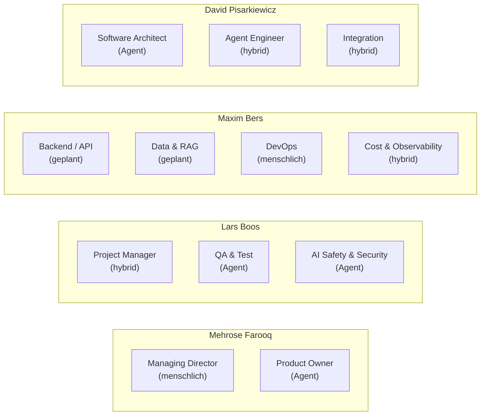
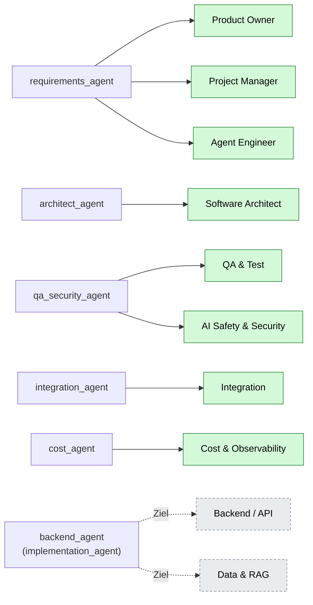
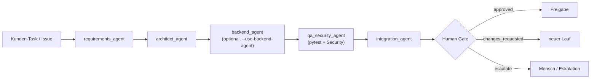

# PepeGroup – Rollen & Agenten (Übersicht)

Stand: Termin 3. 4 Personen, 12 Rollen, 8 davon operativ durch Agenten/hybrid unterstützt.

## 1. Wer verantwortet welche Rolle

## 2. Welcher Agent übernimmt welche Rolle

## 3. Die 12 Rollen im Detail

| # | Rolle | Aktuell | Agent / Funktion | Accountable | Status |
|---|---|---|---|---|---|
| 1 | Managing Director / Customer Lead | Mensch | – | Mehrose | geplant |
| 2 | Product Owner / Requirements | Agent | `requirements_agent` · `run_requirements_analysis` | Mehrose | **operational** |
| 3 | Project Manager | hybrid | `requirements_agent` · `run_project_planning` | Lars | **operational** |
| 4 | Software Architect | Agent | `architect_agent` · `run_architect_review` | David | **operational** |
| 5 | Backend / API | Mensch | `backend_agent` (Ziel) | Maxim | geplant |
| 6 | Data & RAG | Mensch | `implementation_agent` (Ziel) | Maxim | geplant |
| 7 | Agent Engineer | hybrid | `requirements_agent` · `run_agent_engineering_spec` | David | **operational** |
| 8 | Integration | hybrid | `integration_agent` · `run_integration_check` | David | **operational** |
| 9 | QA & Test | Agent | `qa_security_agent` · `run_qa_test_execution` (echtes pytest) | Lars | **operational** |
| 10 | DevOps | Mensch | – | Maxim | geplant |
| 11 | AI Safety & Security | Agent | `qa_security_agent` · `run_security_audit` | Lars | **operational** |
| 12 | Cost & Observability | hybrid | `cost_agent` · `run_cost_analysis` | Maxim | **operational** |

## 4. Die Agenten und ihre Fähigkeiten

| Agent | Fähigkeiten | Strukturierter Output | Rollen |
|---|---|---|---|
| `requirements_agent` | Requirements-Analyse, Projektplanung, Agent-Design | `RequirementsReport`, `ProjectPlanReport`, `AgentDesignReport` | PO, PM, Agent Engineer |
| `architect_agent` | Architektur-Review, Schnittstellen/ADRs | `ArchitectureReport` | Software Architect |
| `qa_security_agent` | QA (führt echtes `pytest` aus), Security-Audit | `QATestExecutionReport`, `QASecurityReport` | QA & Test, AI Safety & Security |
| `integration_agent` | Agent-to-Agent-Handover prüfen | `IntegrationHandoverReport` | Integration |
| `cost_agent` | Traces aggregieren, Kosten/Credits | `CostReport` | Cost & Observability |
| `backend_agent` | Produktdateien implementieren, `pytest` ausführen | `BackendImplementationReport` | Backend/API, Data & RAG (Ziel) |

## 5. Ablauf (Pipeline)

## 6. Menschliche Freigaben (Human Gate)

Freigabepflichtig (`human_approval_required: true`):
**Managing Director, Product Owner, Software Architect, QA & Test, DevOps, AI Safety & Security.**

Regel: Ein LLM-Status `approved` ist **keine** menschliche Freigabe. Headless bleibt die Entscheidung `pending_human_review`.

## 7. Verteilung auf 4 Personen

| Person | Rollen | Anzahl |
|---|---|---|
| Mehrose Farooq | Managing Director, Product Owner | 2 |
| Lars Boos | Project Manager, QA & Test, AI Safety & Security | 3 |
| Maxim Bers | Backend/API, Data & RAG, DevOps, Cost & Observability | 4 |
| David Pisarkiewicz | Software Architect, Agent Engineer, Integration | 3 |

**8 von 12** Rollen operativ agentisch/hybrid (Anforderung bei 4 Personen: ≥ 8).
