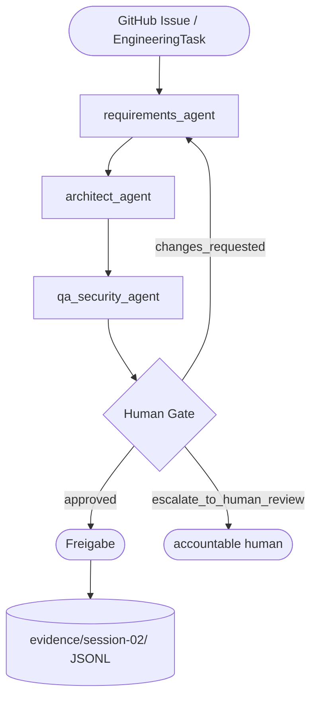

# Architecture

## Current System (Termin 2)

Basis: FastAPI + PostgreSQL/pgvector. Agenten laufen auf **LangGraph + LangChain**
über die Provider-Abstraktion `src/llm/factory.py`.

Eigene Agenten (`src/agents/`): `requirements_agent`, `architect_agent`,
`qa_security_agent`, `cost_agent`.
Workflows (`src/workflows/`): `feature_pipeline` (Agent-to-Agent + Human Gate),
`run_github_issue` (GitHub-Issue-Automation).

### Agent-to-Agent Pipeline: feature_pipeline

- Übergabe ausschließlich über strukturierten State (`EngineeringTask` +
  Pydantic-Reports), kein Copy/Paste.
- Jede Station nutzt die LLM-Abstraktion und erzeugt einen Trace.

### Cost & Observability (Termin 1)

Der `cost_agent` liest das Trace-**Verzeichnis** (`evidence/`, `logs/`),
aggregiert Läufe, Laufzeit und Tokens deterministisch und erzeugt einen
strukturierten `CostReport` (Vorschlag, keine Freigabe).

### GitHub-Issue-Automation

`run_github_issue` wird über `.github/workflows/agent_issue_trigger.yml`
gestartet, setzt das Issue auf *In Progress*, kommentiert das Ergebnis und
schließt es automatisch.

### LLM-Zugang

- Nur über `src/llm/factory.py`; Provider per `.env`: lokal `ollama`
  (`qwen3:4b`), OpenAI-kompatibel (HAW ICC) oder `google` (Gemini).
- Kein Agent-Code hängt direkt von einem konkreten Modell ab.

### Tools and Security

- `read_log_file` / `read_repository_text_file` lesen nur innerhalb des Repos
  (Pfadgrenze per `.resolve()`, blockiert Path Traversal).
- Secrets werden nicht in Traces geschrieben.

### Human Gate / Escalation

- Entscheidungen: `approved` / `changes_requested` / `escalate_to_human_review`.
- Reviewer ist der accountable human (z. B. Product Owner). Ein LLM-Status wie
  `approved` zählt **nicht** als menschliche Freigabe.
- Die Entscheidung steht im Workflow-State und im Artefakt.

### Traces and Cost Path

- Laufzeit-Traces: `logs/*.jsonl` (gitignored); bereinigte Traces in
  `evidence/session-01/` (Termin 1) und `evidence/session-02/` (Termin 2).
- Kosten/Credits: `costs/` (aus den Traces aggregiert).

### Integration with FastAPI / PostgreSQL

- FastAPI liefert `/health`, `/db/health` und die persistente **Work-Item-API**.
- PostgreSQL + pgvector ist die gemeinsame Datenplattform (Work-Items,
  später RAG/Vector Retrieval).

## Baseline Design Decisions

* **Agent Orchestration:** Uses LangGraph.
* **Abstractions:** LangChain provides model/integration abstractions.
* **LLM Independence:** Team code must not depend directly on a specific LLM deployment.
* **Data Platform:** PostgreSQL + pgvector is the common relational and vector data platform.
* **Project Evidence:** Local structured traces are mandatory project evidence.
* **Observability:** LangSmith is optional and cannot replace local evidence.
* **Local Environment:** Ollama normally runs natively on the host when used on macOS.

## Team Changes / ADRs

* **LLM Provider:** Factory-Abstraktion; Agenten laufen je nach `.env` über
  lokale Modelle (Ollama), ICC oder Gemini.
* **Agent-to-Agent:** Ein gemeinsames `EngineeringTask`-Modell und
  State-Übergabe statt manuellem Copy/Paste.
* **Datenaustausch:** Lokale Logs sind gitignored; bereinigte Traces werden nach
  `evidence/` gepusht.
* **Sicherheit:** Datei-Tools blockieren Path Traversal; keine Secrets in Traces.
