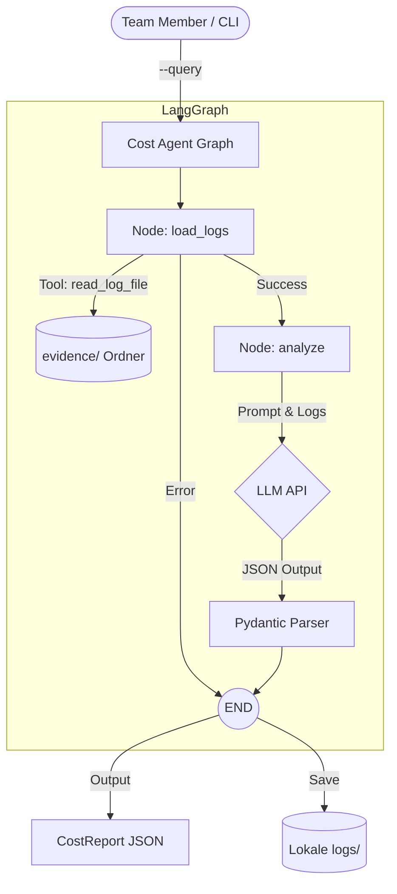

# Architecture

## Current System (Termin 1)

Das aktuelle System basiert auf LangGraph und nutzt einen dedizierten Agenten zur Auswertung von Ausführungsnachweisen (Traces) des gesamten Teams.

### Agentic Flow: Cost & Observability

Der folgende Graph zeigt die Architektur unseres aktuell operativen `cost_observability_agent`:

### Baseline Design Decisions

* **Agent Orchestration:** Uses LangGraph.
* **Abstractions:** LangChain provides model/integration abstractions.
* **LLM Independence:** Team code must not depend directly on a specific LLM deployment.
* **Data Platform:** PostgreSQL + pgvector is the common relational and vector data platform.
* **Project Evidence:** Local structured traces are mandatory project evidence.
* **Observability:** LangSmith is optional and cannot replace local evidence.
* **Local Environment:** Ollama normally runs natively on the host when used on macOS.

## Team Changes

Document all material changes here and add ADRs (Architecture Decision Records) where appropriate.

### Technische Entscheidungen (Termin 1)

* **LLM Provider:** Wir nutzen eine Factory-Abstraktion. Die Agenten laufen flexibel über die Gemini API oder lokale Modelle (z.B. Ollama/oMLX), je nach `.env`-Konfiguration des jeweiligen Teammitglieds.
* **Datenaustausch:** Lokale Logs werden aus Sicherheits- und Konfliktgründen von Git ignoriert (`.gitignore`). Bereinigte Traces werden manuell in das Verzeichnis `evidence/` gepusht. Der Cost Agent liest dieses Verzeichnis dynamisch aus, um Team-übergreifende Auswertungen zu ermöglichen.
* **Sicherheit:** Das Tool `read_log_file` enthält eine strikte Pfadgrenze, um Path Traversal außerhalb von `evidence/` und `logs/` zu blockieren.