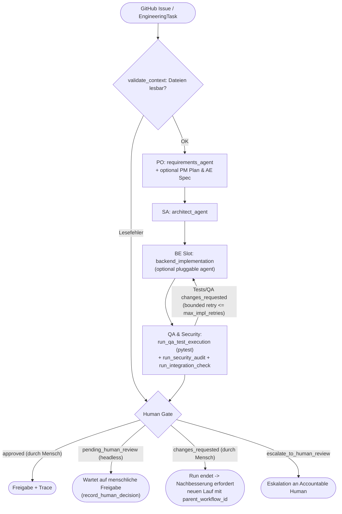

# Architecture

## Current System (Termin 2 / Preparation Termin 3)

Basis: FastAPI + PostgreSQL/pgvector. Agenten laufen auf **LangGraph + LangChain**
über die Provider-Abstraktion `src/llm/factory.py`.

### Operativ unterstützte Rollen (8 von 12 Rollen bei 4 Teammitgliedern)

| # | Role ID (`roles.yaml`) | Agent-Modul & Funktion | Spezifischer Output / Artefakt | Accountable Human |
|---|---|---|---|---|
| 1 | `product_owner_requirements` | `requirements_agent.run_requirements_analysis` | `RequirementsReport` (`acceptance_criteria`) | Mehrose Farooq |
| 2 | `project_manager` | `requirements_agent.run_project_planning` | `ProjectPlanReport` (`work_packages`, `delivery_risks`) | Lars Boos |
| 3 | `agent_engineer` | `requirements_agent.run_agent_engineering_spec` | `AgentDesignReport` (`graph_nodes`, `required_tools`, `state_fields`) | David Pisarkiewicz |
| 4 | `software_architect` | `architect_agent.run_architect_review` | `ArchitectureReport` (`findings`) | David Pisarkiewicz |
| 5 | `qa_test_engineer` | `qa_security_agent.run_qa_test_execution` | `QASecurityReport` + **echte `pytest`-Ausführung** (`pytest_execution`) | Lars Boos |
| 6 | `ai_safety_security_engineer` | `qa_security_agent.run_security_audit` | `QASecurityReport` (`security_risks`, Guardrails) | Lars Boos |
| 7 | `integration_engineer` | `integration_agent.run_integration_check` & `feature_pipeline` | `IntegrationHandoverReport` (`validated_handovers`, `interface_gaps`) | David Pisarkiewicz |
| 8 | `cost_observability_engineer` | `cost_agent.run_cost_analysis` | `CostReport` (ohne Orchestrator-Double-Counting) | Maxim Bers |

### Agent-to-Agent Pipeline (`src/workflows/feature_pipeline.py`)

- **Kontext-Prüfung vor LLM-Aufruf:** Fehlt eine Datei in `input_files`, eskaliert der Workflow sofort mit `calls = 0` an das Human Gate, ohne unnötige LLM-Kosten zu verursachen.
- **Automatische Rückschleife vs. Menschliche Nachbesserung:**
  - Zwischen dem steckbaren `backend_implementation`-Knoten und `qa_security` existiert eine **begrenzte automatische Reparatur-Schleife** (`max_impl_retries`, Standard: 3 Versuche).
  - Entscheidet ein Mensch am **Human Gate** auf `changes_requested`, **endet der aktuelle Lauf**. Nach der Code-Überarbeitung wird ein **neuer Lauf** gestartet, der über `parent_workflow_id` und `human_feedback` im `EngineeringTask` nachvollziehbar mit dem vorherigen Lauf verknüpft wird.

### Human Gate & GitHub-Issue-Automation

- **Kein Auto-Approve im Headless-Modus:** Läuft die Pipeline ohne interaktives Terminal (z. B. in `pytest` oder GitHub Actions), wird niemals automatisch `"approved"` unter dem Namen eines Teammitglieds gesetzt. Stattdessen wird `agent_recommendation` (`approved` / `changes_requested` / `escalate_to_human_review`) dokumentiert und `decision` bleibt auf `"pending_human_review"` (`reviewed_by: None`).
- Eine menschliche Freigabe erfolgt entweder live im interaktiven Terminal (mit Pflicht-Reviewer aus `roles.yaml` und Sicherheitsrückfrage bei Abweichung von der Agenten-Empfehlung) oder nachträglich über `record_human_decision(...)`.
- `run_github_issue.py` schließt ein GitHub Issue **nur dann**, wenn `status == "success"` **und** eine echte menschliche Freigabe (`decision == "approved"` mit gesetztem `reviewed_by`) vorliegt. Bei `pending_human_review`, `changes_requested`, `invalid_output` oder `escalated` bleibt das Issue offen.

### Cost & Observability (`src/agents/cost_agent.py`)

- Der `cost_agent` liest Trace-Dateien aus `evidence/` bzw. `logs/` und schließt Orchestrator-Summenzeilen (`record_type == "workflow_summary"` / `agent == "feature_pipeline_workflow"`) deterministisch aus, um Double-Counting zu verhindern.
- Menschliche Review-Zeit am Gate (`human_review_seconds`) wird getrennt von der reinen Agenten-Laufzeit (`duration_seconds`) erfasst.

### LLM-Zugang & Provider-Begründung

- Alle Agenten nutzen ausschließlich `src/llm/factory.py`.
- Unterstützte Provider per `.env`:
  - `ollama` (lokal, z. B. `qwen3:4b`)
  - `openai_compatible` (vorgesehen für HAW ICC)
  - `google` (`gemini-3.8-flash` über `langchain-google-genai`, deklariert in `requirements.txt`): Wird von David genutzt, da nach Laptop-Wechsel (HP Envy x360) lokale Modelle hardwareseitig nicht lauffähig sind und der HAW-ICC-Endpunkt noch nicht freigeschaltet wurde.
